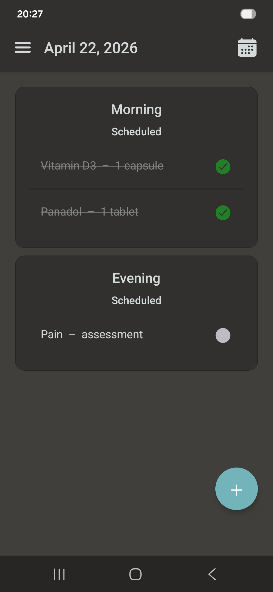
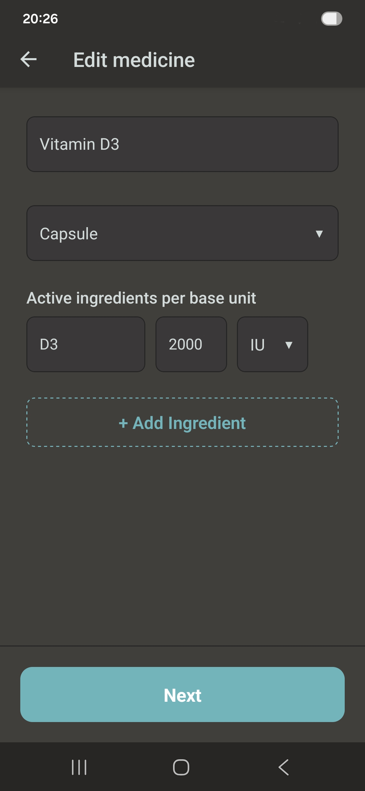
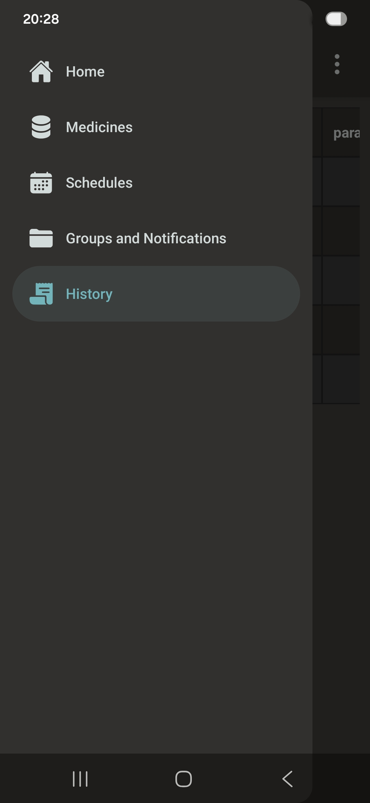

<p align="center">

</p>

# Therapy Track – medicine and assessments tracker

* Track your medicine use and assess your condition using schedules or one-time entries.
* Receive notifications when it is time to take your medicine or complete an assessment.
* View your history and export it to a CSV file.


<p align="center">



</p>

# Installation on Android

The following instructions require only adb (from Android platform-tools) and Docker to be installed. The build process takes place inside a Docker container. The instructions assume a physical Android device, although they work similarly for an emulator.

> [!TIP]
> The commands below have shortcuts in the Makefile.

## Release build

1. Build a release APK.

   ```sh
   docker compose run --rm expo bash -c "npx expo prebuild --platform android && cd android && ./gradlew assembleRelease"
   ```

2. Connect your device and install the release application.

   ```sh
   adb install android/app/build/outputs/apk/release/app-release.apk
   ```

## Development setup

This setup requires a constant connection to the host and allows hot reloading of JavaScript code.

> [!TIP]
> Once the app is installed, steps 1-3 can be omitted unless there are changes in native code or dependencies.

1. Build the development Docker image.

   ```sh
   docker compose build expo
   ```

2. Build the debug APK.

   ```sh
   docker compose run --rm expo bash -c "npx expo prebuild --platform android && cd android && ./gradlew assembleDebug"
   ```

3. Connect your device and install the development application.

   ```sh
   adb install android/app/build/outputs/apk/debug/app-debug.apk
   ```

4. Enable port forwarding.

   ```sh
   adb reverse tcp:8081 tcp:8081
   ```

5. Start the development server.

   ```sh
   docker compose up expo
   ```

6. Open the application on the Android device. From now on, whenever you make code changes, the application should reload.


# Development with VSCode/VSCodium and a container environment

VSCodium doesn't have the proprietary Dev Containers VSCode extension. Instead, it can be connected to the container with the Open Remote - SSH extension.

1. Generate a new SSH key and copy the public key to the project directory.

   ```sh
   ssh-keygen -t ed25519 -N "" -f ~/.ssh/expo-container && mkdir -p ssh && cp ~/.ssh/expo-container.pub ssh/
   ```

2. Build and start the container with the SSH server.

   ```sh
   docker compose up --build expo-sshd
   ```

   The SSH server will be available on localhost on port 50022.

3. In VSCodium, run the command "Remote-SSH: Connect Current Window to Host" and enter the connection string `node@localhost:50022`.